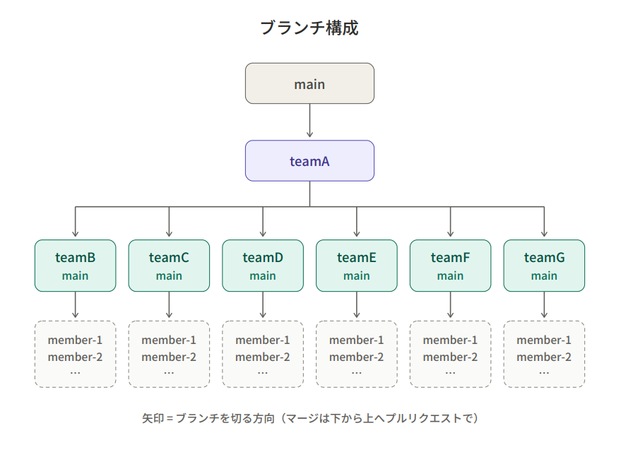

# anabuki2026

チームで作る Web アプリです。
このページには **「自分のパソコンでアプリを動かせるようになるまで」** と **「毎日の作業の流れ」** が書いてあります。

> **はじめての人へ**
> 上から順番に、1 つずつ進めれば大丈夫です。
> わからないところや、エラー（赤い文字や `error` という文字）が出たところで止まったら、**画面のスクリーンショットを撮って** 管理チームに聞いてください。

> **XAMPP で準備ずみの人へ（2026 年 11 月から）**
> 開発環境を XAMPP から **Docker** に移しました（理由と日程は `docker-migration-plan.pdf`）。
> [4-2](#4-2-docker-desktop-を入れる)・[4-6](#4-6-env-を作る)・[4-7](#4-7-アプリの箱を作って起動する)・[4-8](#4-8-vs-code-の候補表示の準備をする) だけをやってください。クローンし直す必要はありません。
> Docker が動かないときは、12/9（水）の授業までは XAMPP で作業できます（[9 章](#xampp-で作業するとき129-まで)）。

---

## もくじ

1. [まず知っておくこと（Git ってなに？）](#1-まず知っておくことgit-ってなに)
2. [使うソフト一覧](#2-使うソフト一覧)
3. [黒い画面の使い方（Git Bash と PowerShell）](#3-黒い画面の使い方git-bash-と-powershell)
4. [はじめての準備（最初の 1 回だけ）](#4-はじめての準備最初の-1-回だけ)
5. [アプリを動かしてみる](#5-アプリを動かしてみる)
6. [毎日の作業の流れ](#6-毎日の作業の流れ)
7. [どのフォルダを触ればいい？](#7-どのフォルダを触ればいい)
8. [やってはいけないこと](#8-やってはいけないこと)
9. [困ったとき（よくあるエラー）](#9-困ったときよくあるエラー)

---

## 1. まず知っておくこと（Git ってなに？）

チームで 1 つのアプリを作るとき、みんながバラバラにファイルを編集すると
「誰のファイルが最新？」「上書きして消えた！」ということが起きます。

それを防ぐ道具が **Git（ギット）** です。
**GitHub（ギットハブ）** は、チームのファイルを置いておくインターネット上の場所です。

```
   あなたのパソコン                         GitHub（みんなの共有場所）
  ┌─────────────┐   プッシュ（送る） →   ┌─────────────┐
  │  作業中の    │ ───────────────────→ │  チーム全員の │
  │  ファイル    │ ←─────────────────── │  ファイル     │
  └─────────────┘   ← プル（もらう）     └─────────────┘
```

### 覚えておく言葉はこれだけ

| 言葉 | 意味 | たとえると |
|---|---|---|
| **リポジトリ** | アプリのファイルを全部まとめた入れ物 | チーム共有のフォルダ |
| **クローン** | GitHub のリポジトリを、自分のパソコンにまるごとコピーすること | 共有フォルダを最初にダウンロード |
| **プル** | GitHub にある最新の変更を、自分のパソコンにもらうこと | 最新版に更新 |
| **コミット** | 自分の変更を「ここまでやった」と記録すること | セーブ |
| **プッシュ** | コミットした変更を GitHub に送ること | セーブデータをみんなに共有 |
| **ブランチ** | 自分専用の作業コース。他の人の作業とぶつからない | 自分用のコピーで練習する |
| **プルリクエスト（PR）** | 「自分の変更を本番に入れてください」とお願いすること | 先生に提出してチェックしてもらう |
| **main（メイン）** | 完成版を置く大事なブランチ。直接さわらない | 提出済みの清書 |
| **チームの main** | `teamB/main` のように、チームごとにある「チームの完成版」 | チームで集めた下書き |

アプリを動かすのには **Docker（ドッカー）** を使います。

| 言葉 | 意味 | たとえると |
|---|---|---|
| **コンテナ（箱）** | アプリを動かすのに必要なもの（PHP・Apache・データベース）を、まとめて入れた箱。全員がまったく同じ箱を使う | 中身が決まった「お弁当箱」 |
| **Docker Desktop** | 箱を動かすソフト | お弁当箱を温める電子レンジ |

全員が同じ箱を使うので、「あの人のパソコンでは動くのに」が起きにくくなります。
PHP やデータベースを自分のパソコンに入れる必要もありません。

このチームでは、コマンド（命令文）を入力する黒い画面を **2 つ** 使い分けます。

- **Git の操作** → **Git Bash（ギットバッシュ）**
- **それ以外**（Docker・CakePHP・Composer など）→ **PowerShell（パワーシェル）**

コマンドはこのページからコピーして貼り付ければ大丈夫です。どちらで実行するかは、コマンドの前に書いてあります。

---

## 2. 使うソフト一覧

| ソフト | 何に使う？ |
|---|---|
| **Git（Git Bash）** | Git を使う。Git のコマンドを打つ黒い画面もこれ |
| **PowerShell** | Git 以外のコマンドを打つ黒い画面。Windows に最初から入っている |
| **Docker Desktop** | アプリの箱（PHP・Apache・データベース）を動かす |
| **VS Code** | ファイルを編集する |
| **GitHub のアカウント** | 共有場所に入るため |

> デザインだけを担当する人（Figma などで作るだけの人）は、このページの作業は不要です。

### このアプリのバージョン

| もの | バージョン | どこにある？ |
|---|---|---|
| CakePHP（このアプリの土台） | 5.4 | `vendor/`（`composer install` で入る） |
| PHP | **8.4.28** | Docker の箱の中（自分のパソコンに入れなくてよい） |
| データベース | **MariaDB 10.11** | Docker の箱の中（公開する Xserver と同じ） |

> **Docker を使うのは、開発（自分のパソコン）だけです。**
> 公開するときは、Xserver のレンタルサーバーで、PHP と MariaDB で動かします。公開サーバーでは Docker は使いません。

---

## 3. 黒い画面の使い方（Git Bash と PowerShell）

| 画面 | 何に使う？ | 開き方 |
|---|---|---|
| **Git Bash** | **Git の操作だけ**（`git` で始まるコマンド） | スタートメニューで **「Git Bash」** と検索。Git を入れる（[4-1](#4-1-git-を入れるprogate-の手順どおり)）と使えるようになります |
| **PowerShell** | **Git 以外のすべて**（`docker` など） | スタートメニューで **「PowerShell」** と検索して、**「Windows PowerShell」** を開きます（管理者として実行する必要はありません） |

2 つは、フォルダの場所の書き方がちがうので注意してください。

| 画面 | `C:\xampp\htdocs\anabuki2026` の書き方 |
|---|---|
| Git Bash | **`/c/xampp/htdocs/anabuki2026`**（区切りは `/`、`C:` は `/c`） |
| PowerShell | **`C:\xampp\htdocs\anabuki2026`**（エクスプローラーと同じ） |

> XAMPP は使いませんが、フォルダの場所は今までどおり `C:\xampp\htdocs\anabuki2026` にそろえています。

### コマンドの貼り付け方（大事）

| 画面 | 貼り付け方 |
|---|---|
| Git Bash | **`Ctrl + V` では貼り付けできません。** **`Shift + Insert`** か、画面の上で **右クリック →「Paste」** |
| PowerShell | **`Ctrl + V`** か、画面の上で **右クリック** |

どちらも、コピーは文字をマウスでなぞって選ぶだけでできます。`Ctrl + C` は「止める」という意味になるので注意してください。

### 覚えておくと便利なコマンド（どちらの画面でも使えます）

| コマンド | 意味 |
|---|---|
| `pwd` | 今いるフォルダの場所を表示 |
| `ls` | 今いるフォルダの中身を表示 |
| `cd フォルダ名` | フォルダに移動 |
| `Ctrl + C` | 動いているものを止める |

このアプリのフォルダに移動するコマンドは、画面によってちがいます。

```bash
# Git Bash
cd /c/xampp/htdocs/anabuki2026
```

```powershell
# PowerShell
cd C:\xampp\htdocs\anabuki2026
```

---

## 4. はじめての準備（最初の 1 回だけ）

### 4-1. Git を入れる（Progate の手順どおり）

**Progate の「【Windows】Gitの環境構築をしよう！」のページを見ながら進めてください。**

👉 <https://prog-8.com/docs/git-env-win>

最後に Git Bash で次のコマンドを実行して、確認します。

```bash
git --version
git config --global user.name
git config --global user.email
```

- 1 行目に `git version 2.xx.x...` と出れば、Git は入っています。
- 2・3 行目に、Progate の手順で設定した **名前** と **メールアドレス** が出れば OK です。
  何も出なければ、Progate のページの「ユーザー名・メールアドレスの設定」をやり直してください。

> メールアドレスは、**GitHub に登録したもの** と同じにしておくと、GitHub で自分の作業だとわかるようになります。

### 4-2. Docker Desktop を入れる

Docker Desktop には、**メモリ 8GB 以上** と、**仮想化（パソコンの設定）が有効になっていること** が必要です。

1. <https://docs.docker.com/desktop/setup/install/windows-install/> を開き、**「Docker Desktop for Windows - x86_64」** をダウンロードします。
2. ダウンロードしたファイルを実行します。途中の **「Use WSL 2 instead of Hyper-V」** にはチェックを入れたままにします。
3. インストールが終わったら、**パソコンを再起動** します。
4. スタートメニューから **Docker Desktop** を開き、利用規約に **「Accept」** を押します。
   サインイン（ログイン）の画面は **「Skip」** で飛ばしてかまいません。
5. 左下に **「Engine running」**（緑色）と出れば準備完了です。

> 「WSL needs updating」と出たら、PowerShell で `wsl --update` を実行してから、Docker Desktop を開き直してください。
> 「Virtualization support not detected」と出たら、パソコンの設定（BIOS）で仮想化を有効にする必要があります。自分でさわらずに、管理チームに相談してください。

> **Docker Desktop は、作業するときに起動しておく必要があります。** タスクバーの右下にクジラのアイコンがあれば動いています。
> パソコンを再起動すると止まっていることがあるので、`docker` のコマンドが失敗したら、まずここを確かめてください。

### 4-3. VS Code を入れる

<https://code.visualstudio.com/> からダウンロードしてインストールします。

> 拡張機能（VS Code に足す便利な道具）は、[4-5](#4-5-リポジトリをクローンする自分のパソコンにコピー) のあとに入れます。
> `anabuki2026` フォルダを VS Code で開くと、右下に **「このリポジトリ用のおすすめ拡張機能をインストールしますか？」** と出るので、**「インストール」** を押してください。
> そのあと、次の 1 つだけ設定します（PHP の候補が 2 つずつ出るのを防ぎます）。
>
> 1. 左の四角いアイコン（拡張機能）を押して、検索欄に **`@builtin php`** と入れます。
> 2. **「PHP Language Features」** の歯車 →「無効にする」を押します。
>    **「PHP Language Basics」は無効にしないでください**（コードに色が付かなくなります）。

> **AI（Claude Code・Codex）を使う人へ**
> このリポジトリでは、AI に次の 2 つを守らせる設定をしています（くわしくは [AGENTS.md](AGENTS.md)）。
>
> - `.env` ファイルの中身は、AI に絶対に見せない。
> - git の操作（コミット・プッシュなど）は、AI にさせずに自分で行う。AI はコマンドを教えるだけです。
>
> Claude Code・Codex でこのフォルダを初めて開くと、**「このフォルダを信頼しますか？（trust）」** と聞かれます。**信頼する** を選んでください。
> 特に Codex は、信頼しないと上のルールを守らせる設定が効きません。

### 4-4. GitHub のアカウントを作って、チームに入れてもらう

1. <https://github.com/> でアカウントを作ります（4-1 で設定したメールアドレスで）。
2. 作った **ユーザー名** を管理チームに伝えます。
3. 管理チームから招待メールが届いたら、メールのボタンを押して参加します。

> 招待メールが見つからないときは、GitHub にログインした状態で <https://github.com/orgs/anabuki2026-2027/invitation> を開くと、参加ボタンが出ます。

### ✅ ここまでできたかチェック（授業で確認します）

授業で、次の 3 つができているかを確認します。先に自分で確かめておいてください。

まず Docker Desktop を起動してから、PowerShell を開いて、次の 2 行をまとめて貼り付けて `Enter` を押します。

```powershell
docker --version
docker compose version
```

次に Git Bash を開いて、次の 1 行を貼り付けて `Enter` を押します。

```bash
git --version
```

| チェック | OK のしるし | ダメだったら |
| --- | --- | --- |
| **Docker 導入** | `Docker version` で始まる行と、`Docker Compose version` で始まる行が出る | [4-2](#4-2-docker-desktop-を入れる) をやる |
| **Git 導入** | `git version 2.` で始まる行が出る | [4-1](#4-1-git-を入れるprogate-の手順どおり) をやる |
| **Organization の参加** | ブラウザで <https://github.com/settings/organizations> を開くと、一覧に **`anabuki2026-2027`** がある | 上の 3 の招待を受ける。招待が来ていなければ管理チームに聞く |

> 「認識されません」や `command not found` と出たときは、その画面を **一度閉じて開き直して** から、もう一度ためしてください。
> それでもダメなら、画面のスクリーンショットを撮って管理チームに聞いてください。

> ⚠️ このリポジトリは、Organization に入っていなくても **クローン（コピー）だけはできてしまいます**。
> でも、入っていないと **プッシュ（GitHub に送る）ができません**。クローンできたから大丈夫、と思わずに、必ず確認してください。

### 4-5. リポジトリをクローンする（自分のパソコンにコピー）

まず PowerShell で、置き場所のフォルダを作ります（すでにあれば、何も起きません）。

```powershell
New-Item -ItemType Directory -Force C:\xampp\htdocs | Out-Null
```

次に Git Bash で、次のコマンドを **1 行ずつ** 貼り付けて `Enter` を押します。

```bash
cd /c/xampp/htdocs
git clone https://github.com/anabuki2026-2027/anabuki2026.git anabuki2026
cd anabuki2026
```

- はじめての時は、**GitHub のログイン画面** が出ます。「Sign in with your browser」を押して、ブラウザでログインしてください。
- 終わると `C:\xampp\htdocs\anabuki2026` フォルダができています。`ls` で中身が見えれば OK です。

### 4-6. `.env` を作る

`.env` は、データベースのパスワードなど、**自分のパソコン専用の値** を書くファイルです。GitHub には送られません。
見本の `.env.example` をコピーして作ります。ここからは Git ではないので、**PowerShell** を使います。

```powershell
cd C:\xampp\htdocs\anabuki2026
Copy-Item .env.example .env
```

**中身は書きかえなくて大丈夫です。** コピーしたままの値で動きます。

> `.env` は AI（Claude Code・Codex）に見せないルールです。`.env` のことで困ったら、管理チームに相談してください。

### 4-7. アプリの箱を作って起動する

Docker Desktop が起動していることを確かめてから、PowerShell で、次のコマンドを 1 行ずつ実行します。

```powershell
cd C:\xampp\htdocs\anabuki2026
docker compose up -d --build
docker compose exec web composer install
```

- 1 つ目のコマンドで、箱を作って起動します。**初めてのときは、部品のダウンロードで 3〜5 分** かかります。2 回目からは数秒です。
- 2 つ目のコマンドで、アプリの部品（CakePHP など）を箱の中に入れます。
  `config/app_local.php`（自分のパソコン専用の設定）も、このとき自動で作られます。

最後のほうにエラーが出ていなければ OK です。

> データベース（`anabukiit_app`）は、箱を初めて起動したときに自動で作られます。自分で作る必要はありません。
> `config/app_local.php` のデータベースの設定も、書きかえる必要はありません（Docker 側から渡しています）。

### 4-8. VS Code の候補表示の準備をする

VS Code で CakePHP の関数の候補を出すために、箱の中の部品を、自分のパソコンにもコピーします（1 分くらいかかります）。

```powershell
cd C:\xampp\htdocs\anabuki2026
docker compose cp web:/var/www/html/vendor/. vendor
```

> アプリは箱の中の部品で動くので、このコピーは VS Code のためだけのものです。
> XAMPP で準備ずみの人は、もう `vendor/` があるので、やらなくても大丈夫です。

---

## 5. アプリを動かしてみる

1. ブラウザで **<http://localhost:8765>** を開きます。
2. CakePHP の画面が出て、**緑のチェックがたくさん並んでいれば成功** です 🎉
   特に **「CakePHP is able to connect to the database.」** が緑ならデータベースもつながっています。
3. データベースの中身は、**<http://localhost:8081>**（phpMyAdmin）で見られます。

> 箱は、一度起動すれば **ずっと動いています**（パソコンを再起動しても、Docker Desktop を開けば自動で起動します）。
> 今までの `bin/cake server` のように、PowerShell を開きっぱなしにする必要はありません。

### Docker のよく使うコマンド

どれも **PowerShell** で、`cd C:\xampp\htdocs\anabuki2026` をしてから実行します。

| やりたいこと | コマンド |
|---|---|
| 箱を起動する | `docker compose up -d` |
| 箱を止める | `docker compose down` |
| 箱が動いているか見る | `docker compose ps` |
| アプリのログ（エラーの内容）を見る | `docker compose logs -f web`（`Ctrl + C` で終わる） |
| `bin/cake` のコマンドを動かす | `docker compose exec web bin/cake ○○`（例：`docker compose exec web bin/cake migrations migrate`） |
| 部品をそろえる | `docker compose exec web composer install` |
| プルリクエストの前にまとめてチェック | `docker compose exec web composer check` |
| 箱の中に入って作業する | `docker compose exec web bash`（`exit` で出る） |

> `bin/cake` と `composer` のコマンドは、**頭に `docker compose exec web` を付けて** 箱の中で動かします。
> チーム別ガイドなどに出てくるコマンドも、すべてこの形で書いてあります。

---

## 6. 毎日の作業の流れ

### ブランチのしくみ

このチームでは、ブランチを **3 段** に分けて使います。



図の名前は、実際には次のブランチ名になります。

| 図の名前 | 実際のブランチ名 | 何のブランチ？ |
| --- | --- | --- |
| main | `main` | 完成版（A チームだけがマージする） |
| teamA | `teamA/main` | A チームが全チームの作業を集めてチェックする場所 |
| teamB main 〜 teamG main | `teamB/main` 〜 `teamG/main` | 各チームの完成版（そのチームのリーダー・副リーダーがマージする） |
| member-1、member-2 … | `teamB/tanaka-users-model` など | メンバー 1 人 1 人の作業ブランチ |

作業は、下から上へ順番に上がっていきます。

```text
① メンバー     ：自分の作業ブランチ → チームの main にプルリクエスト
                    （チームのリーダー・副リーダーがチェックしてマージ）
② リーダー     ：1 つの機能ができたら、チームの main → teamA/main にプルリクエスト
                    （A チームがチェックしてマージ）
③ A チーム     ：teamA/main → main にマージ
④ リーダー     ：main に入った最新版を、チームの main に取り込む（→ 他のチームの作業がもらえる）
```

このページの `teamB` の部分は、**自分のチーム**（`teamA` 〜 `teamG`。**チームの文字は大文字**）に読みかえてください。

> リーダー・副リーダーの作業（②・④）は、[チーム別ガイド](docs/teams/README.md#リーダー副リーダーの仕事) を見てください。
> ここから下は、**メンバー全員**の毎日の作業です。

---

作業するときは、**毎回この順番** で進めます。

```
 ① 最新版をもらう → ② ブランチを作る → ③ 作業する → ④ コミット → ⑤ プッシュ → ⑥ プルリクエスト
```

① 〜 ⑤ の `git` のコマンドは、すべて **Git Bash** で実行します。まず、Git Bash でアプリのフォルダに移動しておきます。

```bash
cd /c/xampp/htdocs/anabuki2026
```

### ① 最新版をもらう（プル）

**自分のチームの main** に移動して、最新版をもらいます。

```bash
git fetch
git switch teamB/main
git pull
```

**作業を始める前に必ずやります。** 他の人の変更を取り込んでおかないと、あとでぶつかります。

> プルしたあとに、管理チーム（A チーム）やリーダーから「`composer install` してね」「`bin/cake migrations migrate` してね」と言われたら、そのコマンドも実行してください。
> Git ではないので **PowerShell** で、`cd C:\xampp\htdocs\anabuki2026` をしてから、頭に `docker compose exec web` を付けて実行します。
>
> ```powershell
> docker compose exec web composer install
> docker compose exec web bin/cake migrations migrate
> ```

### ② ブランチを作る（自分専用の作業コース）

```bash
git switch -c teamB/tanaka-users-model
```

- `teamB/tanaka-users-model` の部分は **自分のチームと作業に合わせて変えます**。
  決まり：`teamX/名前-作業内容`（X は自分のチームの大文字 1 文字。名前と作業内容は英語の小文字とハイフンで）
- 今どのブランチにいるかは `git branch` で確認できます（`*` が付いているのが今のブランチ）。

> **main やチームの main のまま作業しないでください。** 必ず自分のブランチを作ってから作業します。

### ③ 作業する

VS Code でファイルを編集して保存します。
保存したら、ブラウザ（<http://localhost:8765>）を再読み込みするだけで、すぐに反映されます。

> VS Code のメニューの **「ターミナル」→「タスクの実行...」** から、よく使うコマンドを選んで実行できます。
> プッシュする前に **「プルリクエストの前にまとめてチェック」** を選んで、エラーが出ないか確認しておくと安心です
> （プルリクエストを出すと GitHub でも同じチェックが動きます）。

### ④ コミット（セーブ）

```bash
git status
```

まず `git status` で **変更したファイルの一覧** を確認します（赤い文字で出ます）。
自分が触っていないファイルが出ていたら、コミットせずに管理チームに聞いてください。
**`.env` が出ていたら、絶対にコミットしないでください**（ふつうは出ない設定になっています）。

問題なければ、次の 2 つを実行します。

```bash
git add .
git commit -m "トップページのヘッダーを作成"
```

- `git add .` は「変更したファイルを全部セーブ対象にする」という意味です。
- `" "` の中には **何をしたか** を日本語で書きます。

### ⑤ プッシュ（GitHub に送る）

```bash
git push -u origin teamB/tanaka-users-model
```

`teamB/tanaka-users-model` の部分は、②で作った **自分のブランチ名** にします。
（2 回目からは `git push` だけで大丈夫です）

### ⑥ プルリクエスト（チェックをお願いする）

1. ブラウザで GitHub のリポジトリを開きます。
2. 黄色い帯の **「Compare & pull request」** を押します。
3. **【いちばん大事】画面の上にある `base: main` を押して、自分のチームの main（例：`teamB/main`）に変えます。**

   ```text
   base: teamB/main  ←  compare: teamB/tanaka-users-model
   ```

   > `base` が `main` のままだと、チェックを飛ばして完成版に入れようとしてしまいます。
   > まちがえたら、プルリクエストの画面の右上「Edit」から `base` を直せます。

4. 何をしたかを書いて **「Create pull request」** を押します。
5. チームのリーダー・副リーダーが確認して OK なら、チームの main に入ります（これを「マージ」と言います）。

### マージされたら

次の作業は、また **① からスタート** です（新しいブランチを作ります）。

### 他のチームの作業をもらうには

他のチームの作業は、**main → チームの main** の順番で届きます。
リーダーから「チームの main を更新したよ」と連絡が来たら、① の `git pull` をすると、他のチームの作業も入ってきます。

作業の途中で、自分のブランチにも取り込みたいときは、自分のブランチにいる状態で次を実行します。

```bash
git fetch
git merge origin/teamB/main
```

> `CONFLICT` と出たら、自分で直そうとせずに、リーダーか A チームに相談してください。

### コマンドまとめ（慣れてきたらこれだけ見ればOK）

すべて **Git Bash** で実行します。

```bash
cd /c/xampp/htdocs/anabuki2026
git fetch
git switch teamX/main
git pull
git switch -c teamX/名前-作業内容
# …作業する…
git status
git add .
git commit -m "何をしたか"
git push -u origin teamX/名前-作業内容
# → GitHub でプルリクエスト（base を teamX/main にする！ X は自分のチームの大文字）
```

---

## 7. どのフォルダを触ればいい？

```
anabuki2026/
├── templates/        ← 画面の HTML（C チーム）
├── webroot/
│   ├── css/          ← 見た目（CSS）（E チーム）
│   ├── js/           ← 動き（JavaScript）
│   └── img/          ← 画像（E チーム）
├── src/
│   ├── Controller/   ← 画面とデータのつなぎ役（D チーム）
│   └── Model/        ← データベースのやりとり（B チーム）
├── config/           ← 設定（基本は A チームだけ）
├── vendor/           ← 自動でダウンロードされた部品（触らない）
├── docker/           ← Docker の箱の中の設定（A チームだけ）
├── compose.yml       ← Docker の箱をまとめて動かす設定（A チームだけ）
├── Dockerfile        ← Docker の箱の作り方（A チームだけ）
├── .env              ← 自分のパソコン専用の値（GitHub に送らない）
├── composer.json     ← 部品のリスト（管理チームだけ）
└── README.md         ← このファイル
```

| チーム | 担当 | 主に触るところ |
|---|---|---|
| A | 全体の統括・管理（管理チーム） | `config/`、`composer.json`、`composer.lock`、`.github/`、`compose.yml`、`Dockerfile`、`docker/` |
| B | Model | `src/Model/` |
| C | View | `templates/`、`src/View/` |
| D | Controller | `src/Controller/` |
| E | デザイン | `webroot/css/`、`webroot/img/`、`webroot/font/` |
| F | DB | `config/Migrations/`、`config/Seeds/` |
| G | テスト | `tests/` |

> **自分のチームの作業のしかたは [チーム別ガイド](docs/teams/README.md) を見てください。**
> 1 つ 1 つのファイルが何をしているかは [docs/FILES.md](docs/FILES.md) にまとめてあります。

> 画面に出すデータやフォームの送信は Controller とつながっています。
> C チーム（View）の人も、困ったら D チーム（Controller）の人と相談しましょう。

---

## 8. やってはいけないこと

| ダメなこと | 理由 |
|---|---|
| ❌ main ブランチやチームの main で直接作業する | みんなの完成版が壊れます。必ず自分のブランチで |
| ❌ プルリクエストの `base` を `main` のまま出す | チームと A チームのチェックを飛ばしてしまいます。必ずチームの main に |
| ❌ `git pull` せずに作業を始める | 他の人の変更とぶつかります |
| ❌ `git push --force` を使う | 他の人の作業が消えることがあります |
| ❌ `vendor/` の中を編集する | `composer install` のたびに元に戻ります |
| ❌ `composer update` を勝手に実行する | 部品のバージョンが変わり、みんなの環境がこわれます（管理チームだけが実行） |
| ❌ パスワードなどを GitHub に送る（`.env` をコミットする など） | インターネット上に残ってしまいます |
| ❌ `compose.yml`・`Dockerfile`・`docker/` を勝手に変える | 全員の環境がそろわなくなります。PHP や MariaDB の版もここで決めています（管理チームだけが変える） |
| ❌ `docker compose down -v` を勝手に実行する | 自分のパソコンのデータベースの中身が、全部消えます（管理チームに言われたときだけ） |

> ネットで調べて出てきたコマンドを、意味がわからないまま実行するのはやめましょう。まず管理チームに聞いてください。

---

## 9. 困ったとき（よくあるエラー）

人に聞くときは、次の 3 つをセットで伝えてください。そろっていれば、誰でも助けられます。

1. 何をしようとしたか
2. エラーの画面（スクリーンショット）
3. PowerShell で `docker compose logs web --tail 20` を実行した結果

### セットアップのとき

| 出たメッセージ・起きたこと | 原因 | どうする？ |
|---|---|---|
| Git Bash で `Ctrl + V` で貼り付けできない | Git Bash ではそういう仕様 | `Shift + Insert` か 右クリック →「Paste」 |
| PowerShell で「〇〇 の用語は、コマンドレット、関数、…として認識されません」／ Git Bash で `command not found` | インストール直後でまだ反映されていない | その画面を **全部閉じて** 開き直す。だめならパソコンを再起動 |
| `docker` で `error during connect` / `cannot find the file specified` / `Is the docker daemon running?` | Docker Desktop が起動していない | Docker Desktop を開いて、「Engine running」になってからやり直す |
| Docker Desktop で `WSL needs updating` | WSL（Docker が使う Windows の機能）が古い | PowerShell で `wsl --update` を実行して、Docker Desktop を開き直す |
| Docker Desktop で `Virtualization support not detected` | パソコンの仮想化が無効になっている | 管理チームに相談（BIOS の設定が必要） |
| `.env がありません。.env.example をコピーして .env を作ってください` | `.env` を作っていない | [4-6](#4-6-env-を作る) をやる |
| `Repository not found` / `Permission denied` | GitHub のチームに入っていない / 別のアカウントでログインしている | [4-4](#4-4-github-のアカウントを作ってチームに入れてもらう) の招待を受けたか確認 |
| `fatal: destination path 'anabuki2026' already exists` | もうクローン済み | `cd anabuki2026` で中に入れば OK |
| `No such file or directory` / 「パスが存在しないため検出できません」 | 今いるフォルダが違う | Git Bash なら `cd /c/xampp/htdocs/anabuki2026`、PowerShell なら `cd C:\xampp\htdocs\anabuki2026` をしてからやり直す |

### アプリを動かすとき

| 出たメッセージ・起きたこと | 原因 | どうする？ |
|---|---|---|
| <http://localhost:8765> が開けない | 箱が止まっている | `docker compose ps` で `web` と `db` が `Up` か見る。なければ `docker compose up -d` |
| 画面に **「CakePHP is NOT able to connect to the database」** | データベースの箱がまだ起動中 | 30 秒待ってから再読み込み。直らなければ `docker compose ps` で `db` が `healthy` か見る |
| `Class "○○" not found` / `vendor/autoload.php` がない | 箱の中の部品が足りない・古い | `docker compose exec web composer install` |
| `port is already allocated` / `ports are not available` | 8765・8081・3307 番を、ほかのもの（`bin/cake server` など）が使っている | 前の `bin/cake server` を `Ctrl + C` で止める。わからなければ管理チームに相談 |
| `service "web" is not running` | 箱が止まっている | `docker compose up -d` をしてから、もう一度実行する |
| 保存したのに画面が変わらない | ブラウザが前の画面を覚えている（キャッシュ） | `Ctrl + Shift + R` で読み直す |
| VS Code で CakePHP の候補が出ない | 自分のパソコンに `vendor/` がない | [4-8](#4-8-vs-code-の候補表示の準備をする) をやる |

### Git のとき

| 出たメッセージ・起きたこと | 原因 | どうする？ |
|---|---|---|
| 変な画面になって文字が打てない（左下に `:` や `(END)`） | 長い結果を表示するモードになっている | `q` を押す |
| `git commit` したら、よくわからない画面（エディタ）が開いた | `-m "..."` を付け忘れた | 管理チームに相談（あわてて閉じない） |
| `Please tell me who you are` | 名前とメールアドレスを設定していない | [4-1](#4-1-git-を入れるprogate-の手順どおり) の設定をやる |
| `Your local changes ... would be overwritten` | 作業途中のままブランチを変えようとした | 先にコミットする。わからなければ管理チームに相談 |
| `CONFLICT`（コンフリクト／競合） | 他の人と同じ場所を編集した | **自分で直そうとせず**、そのまま管理チームに相談 |
| `rejected` / `failed to push` | GitHub の方が新しくなっている | 管理チームに相談 |

### XAMPP で作業するとき（12/9 まで）

Docker がどうしても動かない人は、**12/9（水）の授業まで** は、今までの XAMPP で作業できます。

1. PowerShell で `docker compose down` を実行して、箱を止めます（Docker が動いていなければ不要）。
2. XAMPP Control Panel で **MySQL** を「Start」にします。
3. PowerShell で、次を実行して、<http://localhost:8765> を開きます。

```powershell
cd C:\xampp\htdocs\anabuki2026
bin/cake server
```

> XAMPP のデータベースは MySQL で、公開する Xserver（MariaDB）とはちがいます。できるだけ早く Docker に移ってください。
> 12/9 のあとは、XAMPP での作業はできなくなります。

---

## 参考リンク

- Progate「【Windows】Gitの環境構築をしよう！」：<https://prog-8.com/docs/git-env-win>
- Docker Desktop を Windows に入れる（英語）：<https://docs.docker.com/desktop/setup/install/windows-install/>
- CakePHP 5 公式ドキュメント（日本語）：<https://book.cakephp.org/5/ja/index.html>
- CakePHP のインストール方法：<https://book.cakephp.org/5/ja/installation.html>
