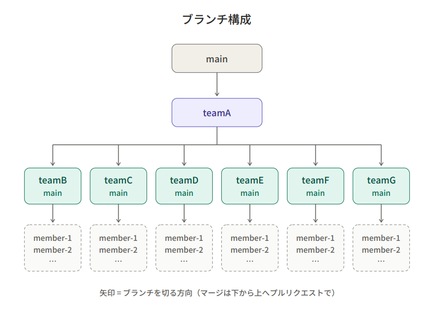

# A チーム（全体の統括・管理）

[← チーム別ガイドにもどる](README.md)

## ひとことで

**プロジェクト全体の「司令塔」です。**
どの機能を作るかを決め、チームどうしの名前やルールをそろえ、各チームから `main` に届いた作業をチェックして、main に入れます。
アプリ全体の設定ファイルも A チームが管理します。

---

## A チームの仕事

1. **作る機能を決めて、各チームに割りふる**
2. **名前の一覧を作って共有する**（表の名前・URL・画面の名前など。[名前の決まり](README.md#全チーム共通名前の決まり)を参照）
3. **各チームのリーダー・副リーダーから `main` に届いたプルリクエストを、自分のパソコンで動かして確かめてから、main にマージする**
4. **リーダー・副リーダーに連絡する**（「main を更新したので取り込んでね」「`bin/cake migrations migrate` してね」など）
5. **設定ファイルを管理する**
6. **困っている人を助ける**（わからないことは最終的に A チームに集まります）

A チームには、チームの main（`teamA/main`）は**ありません**。
A チームのメンバー自身の作業は、`main` から `teamA/名前-作業内容` のブランチを作って、**`main` にプルリクエストを出します**。

```bash
cd /c/xampp/htdocs/anabuki2026
git fetch
git switch main
git pull
git switch -c teamA/tanaka-update-readme
```

> A チームのメンバーが出したプルリクエストは、どのブランチからでも `main` に出せます（`.github/workflows/main-source-branch-check.yml` で、Actions の変数 `TEAM_A_MEMBERS` に登録した人）。
> A チームに人が増えたり減ったりしたら、管理者が `TEAM_A_MEMBERS` を直してください。

---

## さわるファイル・フォルダ

| ファイル | 何をするもの？ |
| --- | --- |
| `README.md` | アプリの説明書。手順が変わったら更新する。 |
| `docs/` | このガイドのページたち。チームのルールが変わったら更新する。 |
| `composer.json` | 使う部品（ライブラリ）の「買い物リスト」。 |
| `composer.lock` | 使う部品の「レシート」。手では書きかえず、`composer` コマンドで自動更新する。 |
| `config/app.php` | アプリ全体の設定（時間、エラーの出し方、メールなど）。 |
| `config/app_local.example.php` | 各自の `app_local.php` の見本。 |
| `config/bootstrap.php` | アプリが動き出すときの準備。 |
| `config/plugins.php` | 追加機能（プラグイン）の一覧。 |
| `config/routes.php` | URL の案内表。**D チームと相談して**更新する。 |
| `src/Application.php` | 安全チェックなど、すべてのページに共通する処理。 |
| `src/Middleware/` | 安全チェック用のプログラム。 |
| `.gitignore` | GitHub に送らないファイルの一覧。 |
| `phpcs.xml`、`phpstan.neon`、`psalm.xml` | コードのチェック道具の設定。 |
| `.github/` | GitHub の自動チェック（CI）や、Issue・プルリクエストの見本。 |
| `.vscode/` | 全員に効く VS Code の設定・おすすめ拡張機能・タスク。 |
| `AGENTS.md` | AI（Claude Code・Codex）の説明書。チームのルールが変わったら、ここも更新する。 |
| `.agents/` | AI の決まった作業の手順（スキル）。Claude Code と Codex で共通。 |
| `.claude/` | Claude Code の設定と、見張り役（`hooks/guard.php`）。 |
| `.codex/` | Codex の設定・見張り役の呼び出し・禁止のルール。 |

---

## 作業の流れ

### 最初に 1 回だけ：チームの main を作る

下の図の「teamB main」〜「teamG main」にあたる、6 チーム分の main を作ります（作ってあれば不要）。
図の「teamA」にあたるブランチは作りません（A チームは `main` を使います）。


git の操作なので、Git Bash で次を実行します。

```bash
cd /c/xampp/htdocs/anabuki2026
git switch main
git pull
bash scripts/create_branches.sh
```

「作成予定」に並んだブランチを確認してから、`y` を押します。
すでにあるブランチは飛ばすので、もう一度実行しても大丈夫です。

スクリプトを使わずに、1 つずつ作ることもできます。

```bash
git push origin main:teamB/main
git push origin main:teamC/main
git push origin main:teamD/main
git push origin main:teamE/main
git push origin main:teamF/main
git push origin main:teamG/main
```

`git push origin main:teamB/main` は、「今の main と同じ中身で、GitHub に `teamB/main` を作る」という意味です。
GitHub の「branches」の画面で、`teamB/main` 〜 `teamG/main` の 6 つがあることを確認してください。

### ブランチを守る設定（Rules）

GitHub の **Settings → Rules → Rulesets** で、ブランチに「してはいけないこと」を決めています。
設定は GitHub が守らせるので、だれかがまちがえても止めてくれます。
変えるときは、この表も一緒に直してください。

#### main を守るルールセット

| 項目 | 設定 |
| --- | --- |
| 対象（Target branches） | `main` |
| Restrict updates | ✅（bypass list の人しか `main` を変えられない。プルリクエストのマージも同じ） |
| Restrict deletions | ✅ |
| Require a pull request before merging | ✅（Required approvals は `0`、マージの方法は **Merge だけ**） |
| Block force pushes | ✅ |
| Require status checks to pass | 最初のプルリクエストで CI が動いたあとに足す（`testsuite` と `Coding Standard & Static Analysis`）。`main` に出せるブランチを決める `main-source-branch-check` も必須にする |
| Bypass list | **Organization admin**（＝ Organization の Owner。A チームのメンバー） |

#### チームの main を守るルールセット

| 項目 | 設定 |
| --- | --- |
| 対象（Target branches） | `team*/main`（`teamB/main` 〜 `teamG/main`） |
| Restrict updates | ❌（オンにすると、各チームのリーダーがマージできなくなる） |
| Restrict deletions | ✅ |
| Require a pull request before merging | ✅（マージの方法は **Merge だけ**） |
| Block force pushes | ✅ |
| Bypass list | なし |

#### オンにしてはいけない設定

| 項目 | 理由 |
| --- | --- |
| Require linear history | マージコミットが禁止になり、「チームの main → main → チームの main」の流れが使えなくなる |
| マージの方法の Squash・Rebase | 同じ変更が別のコミットになり、main をチームの main に取り込みなおすたびに、コンフリクトが起きやすくなる |
| Require signed commits | 全員がコミットの署名の設定をしないといけなくなる |

#### Organization の Team と権限

| Team | メンバー | 権限 |
| --- | --- | --- |
| `teamA`（親） | A チーム | A チームのメンバーは、1 人ずつ Organization の **Owner** にしている |
| `teamB` 〜 `teamG`（`teamA` の子） | 各チーム | 親の `teamA` の、リポジトリへの権限を受け継ぐ |

> ⚠️ 子の Team は、**親の Team に付けたリポジトリの権限を受け継ぎます**。
> `teamA` のリポジトリの権限（Settings → Collaborators and teams）は **Write** のままにしてください。
> Admin にすると、B〜G の全員も Admin になり、ルールセットを消したり変えたりできてしまいます。
> Owner は 1 人ずつに付く役割なので、子の Team には受け継がれません。
>
> `@teamA` でメンションすると、子の Team の B〜G の全員にも通知が届きます。

### 新しい機能を始めるとき

1. 作る機能を決める（例：会員登録）。
2. 名前を決めて、全チームに共有する。

   | もの | 決めた名前 |
   | --- | --- |
   | 表の名前 | `users` |
   | 表の項目 | `id`、`name`、`email`、`password`、`created`、`modified` |
   | URL | `/users`（一覧）、`/users/add`（登録） |
   | 画面に渡す変数の名前 | `$users`（一覧）、`$user`（1 人分） |

3. GitHub の Issue に「だれが・何を・いつまでに」を書いて、各チームに割りふる。

### 各チームからのプルリクエストをチェックするとき

各チームのリーダー・副リーダーから、`main` あてにプルリクエストが届きます（`base: main ← compare: teamB/main` の形）。
`main` は完成版なので、**マージする前に、自分のパソコンで動かして確かめます。**

1. GitHub でプルリクエストを開いて、次を確認します。

   - [ ] `compare` が `teamB/main` 〜 `teamG/main` のどれかになっている（メンバーの作業ブランチから直接来ていたら、`main-source-branch-check` が赤になる）
   - [ ] 画面下の自動チェック（CI と `main-source-branch-check`）が **緑のチェック** になっている
   - [ ] 「Files changed」に、**そのチームの担当ではないファイル**が入っていない
   - [ ] `vendor/`、`tmp/`、`logs/`、`config/app_local.php`、`.env` が入っていない
   - [ ] パスワードなどの秘密の情報が書かれていない

2. 自分のパソコンで、そのチームの main を動かして、**全部の機能がつながって動くか**を確かめます。

   Git Bash で、そのチームの main をもらいます（例は B チーム）。**ここではコミットしないでください。**

   ```bash
   cd /c/xampp/htdocs/anabuki2026
   git fetch
   git switch teamB/main
   git pull
   ```

   PowerShell で、箱を起動して、部品・表をそろえて、テストを動かします。

   ```powershell
   cd C:\xampp\htdocs\anabuki2026
   docker compose up -d
   docker compose exec web composer install
   docker compose exec web bin/cake migrations migrate
   docker compose exec web composer check
   ```

   最後に、ブラウザで <http://localhost:8765> を開いて、画面を確かめます。
   確かめ終わったら、Git Bash で `git switch main` をして、自分の作業にもどります。

3. 問題なければ **「Merge pull request」** を押します。
   直してほしいところがあれば、そのファイルの行にコメントを書いて返します。

> ⚠️ マージしたあとに「Delete branch」ボタンが出ても、**チームの main（`teamB/main` など）は消さないで**ください。

### マージする順番

チームどうしはつながっているので、基本は次の順番で `main` にマージします。

```text
F（表を作る）→ B（Model）→ D（Controller）→ C（View）・E（デザイン）→ G（テスト）
```

### main を更新したあとの連絡

main を更新したら、**全チームのリーダー・副リーダーに**「main を更新したので、チームの main に取り込んでね」と連絡します。
（取り込み方は[リーダー・副リーダーの仕事](README.md#3-main-の最新版をチームの-main-に取り込む)に書いてあります）

あわせて、main に次のファイルが入っていたら、そのことも伝えます。

| 入っていたファイル | 全員にやってもらうこと |
| --- | --- |
| `composer.lock` | `docker compose exec web composer install` |
| `config/Migrations/` の中のファイル | `docker compose exec web bin/cake migrations migrate` |
| `config/Seeds/` の中のファイル | `docker compose exec web bin/cake seeds run` |
| `compose.yml`・`Dockerfile`・`docker/` | `docker compose up -d --build`（箱を作り直す） |
| `.env.example` | 自分の `.env` に、増えた項目を足す（中身は AI に見せない） |

A チームのメンバーは、`git switch main` → `git pull` で最新版をもらいます（チームの main がないので、取り込みの作業は不要です）。

---

## よく使うコマンド

| コマンド | 何が起きる？ |
| --- | --- |
どれも PowerShell で、`cd C:\xampp\htdocs\anabuki2026` をしてから実行します。

| コマンド | 何が起きる？ |
| --- | --- |
| `docker compose exec web composer install` | `composer.lock` のとおりに部品をそろえる |
| `docker compose exec web composer require ○○` | 新しい部品を追加する（`composer.json` と `composer.lock` が変わる） |
| `docker compose exec web composer cs-check` | コードの書き方がルールどおりかチェックする |
| `docker compose exec web composer cs-fix` | 書き方のまちがいを自動で直す |
| `docker compose exec web composer test` | 自動チェック（テスト）を実行する |
| `docker compose exec web composer check` | 上の `test` と `cs-check` をまとめて実行する |
| `docker compose up -d --build` | `compose.yml`・`Dockerfile` を変えたあとに、箱を作り直す |

> ⚠️ `composer update` は、すべての部品のバージョンを変えてしまいます。
> 実行するときは、必ず全員に連絡してからにしてください。

> 部品を変えたら、自分の Windows 側の `vendor/`（VS Code の候補表示用）も、
> `docker compose cp web:/var/www/html/vendor/. vendor` で更新しておくと、候補が新しくなります。

---

## 開発環境（Docker）の管理

開発環境は、`compose.yml`・`Dockerfile`・`docker/` で、全員分をまとめて決めています。
ここを変えると全員の環境が変わるので、A チームが管理します。

| 変えたいこと | 直す場所 | いっしょに直す場所 |
| --- | --- | --- |
| PHP の版 | `Dockerfile` の `FROM php:8.4.28-apache` | `composer.json` の `require.php` と `config.platform.php`、`.vscode/settings.json`、README・`docs/plugins.md` |
| DB（MariaDB）の版 | `compose.yml` の `image: mariadb:10.11` | Xserver の版と同じにする（`docs/concerns.md` の C-02） |
| PHP の設定 | `docker/php/php.ini` | — |
| DB のパスワードなどの項目 | `compose.yml` と `.env.example` | 全員に、自分の `.env` を直してもらう |

- 版はいつも **最後の番号まで** 書いて固定します（`8.4` ではなく `8.4.28`）。人によって版がずれるのを防ぐためです。
- 変えたら、全員に「`docker compose up -d --build` してね」と連絡します。
- **Docker を使うのは開発だけです。** 公開サーバー（Xserver）では Docker は使わず、Xserver の PHP と MariaDB で動かします。
- 12/9（水）の授業のあとに、README から XAMPP の説明（「XAMPP で作業するとき」）を消します。

---

## ほかのチームとのつながり

| チーム | A チームがすること |
| --- | --- |
| B・D・F | 表の名前・URL などの名前を決めて共有する |
| D | `config/routes.php` を変えたいと相談されたら、一緒に決める |
| C・E | 全体のデザインの方向性（色・雰囲気）を一緒に決める |
| G | テストで見つかった不具合を、担当のチームに割りふる |

---

## やっておくとよいこと

- `.github/ISSUE_TEMPLATE.md` と `.github/PULL_REQUEST_TEMPLATE.md` は、まだ英語のままです。日本語のチーム用の見本に書きかえると、みんなが使いやすくなります。
- 決めた名前の一覧は、`docs/` に 1 つのページとしてまとめておくと、あとで探しやすくなります。
