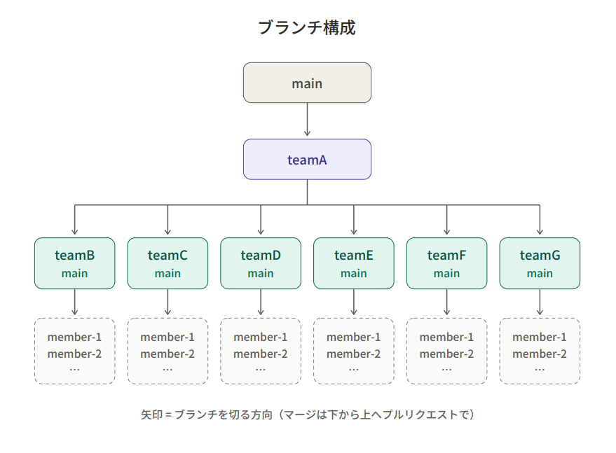

# A チーム（全体の統括・管理）

[← チーム別ガイドにもどる](README.md)

## ひとことで

**プロジェクト全体の「司令塔」です。**
どの機能を作るかを決め、チームどうしの名前やルールをそろえ、各チームから届いた作業を `team-a/main` に集めてチェックし、main に入れます。
アプリ全体の設定ファイルも A チームが管理します。

---

## A チームの仕事

1. **作る機能を決めて、各チームに割りふる**
2. **名前の一覧を作って共有する**（表の名前・URL・画面の名前など。[名前の決まり](README.md#全チーム共通名前の決まり)を参照）
3. **各チームのリーダー・副リーダーから届いたプルリクエストをチェックして、`team-a/main` にマージする**
4. **`team-a/main` で全体がちゃんと動くか確かめて、main にマージする**
5. **リーダー・副リーダーに連絡する**（「main を更新したので取り込んでね」「`bin/cake migrations migrate` してね」など）
6. **設定ファイルを管理する**
7. **困っている人を助ける**（わからないことは最終的に A チームに集まります）

A チームのメンバー自身の作業も、ほかのチームと同じように `team-a/○○` のブランチを作って、`team-a/main` にプルリクエストを出します。

---

## さわるファイル・フォルダ

| ファイル | 何をするもの？ |
| --- | --- |
| `README.md` | アプリの説明書。手順が変わったら更新する。 |
| `docs/` | このガイドのページたち。チームのルールが変わったら更新する。 |
| `composer.json` | 使う部品（ライブラリ）の「買い物リスト」。 |
| `composer.lock` | 使う部品の「レシート」。手では書きかえず、`composer` コマンドで自動更新する。 |
| `config/app.php` | アプリ全体の設定（時間、エラーの出し方、メールなど）。 |
| `config/app_local.example.php` | 各自の `app_local.php` の見本。 |
| `config/bootstrap.php` | アプリが動き出すときの準備。 |
| `config/plugins.php` | 追加機能（プラグイン）の一覧。 |
| `config/routes.php` | URL の案内表。**D チームと相談して**更新する。 |
| `src/Application.php` | 安全チェックなど、すべてのページに共通する処理。 |
| `src/Middleware/` | 安全チェック用のプログラム。 |
| `.gitignore` | GitHub に送らないファイルの一覧。 |
| `phpcs.xml`、`phpstan.neon`、`psalm.xml` | コードのチェック道具の設定。 |
| `.github/` | GitHub の自動チェック（CI）や、Issue・プルリクエストの見本。 |

---

## 作業の流れ

### 最初に 1 回だけ：チームの main を作る

GitHub には今 `main` しかないので、下の図の「teamA」〜「teamG main」にあたる、7 チーム分の main を作ります。


Git Bash で次を実行します。

```bash
cd /c/xampp/htdocs/anabuki2026
git switch main
git pull
git push origin main:team-a/main
git push origin main:team-b/main
git push origin main:team-c/main
git push origin main:team-d/main
git push origin main:team-e/main
git push origin main:team-f/main
git push origin main:team-g/main
```

`git push origin main:team-b/main` は、「今の main と同じ中身で、GitHub に `team-b/main` を作る」という意味です。
GitHub の「branches」の画面で、7 つできていることを確認してください。

> **できればやっておくとよいこと**
> GitHub の「Settings」→「Rules」（または「Branches」）で、`main` と `team-*/main` に
> 「プルリクエストを通さないとマージできない」「消せない」というルールを付けておくと、まちがいを防げます。
> （GitHub のプランによっては使えないことがあります）

### 新しい機能を始めるとき

1. 作る機能を決める（例：会員登録）。
2. 名前を決めて、全チームに共有する。

   | もの | 決めた名前 |
   | --- | --- |
   | 表の名前 | `users` |
   | 表の項目 | `id`、`name`、`email`、`password`、`created`、`modified` |
   | URL | `/users`（一覧）、`/users/add`（登録） |
   | 画面に渡す変数の名前 | `$users`（一覧）、`$user`（1 人分） |

3. GitHub の Issue に「だれが・何を・いつまでに」を書いて、各チームに割りふる。

### 各チームからのプルリクエストをチェックするとき

各チームのリーダー・副リーダーから、`team-a/main` あてにプルリクエストが届きます（`base: team-a/main ← compare: team-b/main` の形）。
GitHub でプルリクエストを開いて、次を確認します。

- [ ] `base` が `team-a/main` になっている（`main` になっていたら、右上の「Edit」で直す）
- [ ] 画面下の自動チェック（CI）が **緑のチェック** になっている
- [ ] 「Files changed」に、**そのチームの担当ではないファイル**が入っていない
- [ ] `vendor/`、`tmp/`、`logs/`、`config/app_local.php` が入っていない
- [ ] パスワードなどの秘密の情報が書かれていない
- [ ] 自分のパソコンでそのブランチを動かして、画面がこわれていない

問題なければ **「Merge pull request」** を押します。
直してほしいところがあれば、そのファイルの行にコメントを書いて返します。

> ⚠️ マージしたあとに「Delete branch」ボタンが出ても、**チームの main（`team-b/main` など）は消さないで**ください。

### マージする順番

チームどうしはつながっているので、基本は次の順番で `team-a/main` にマージします。

```text
F（表を作る）→ B（Model）→ D（Controller）→ C（View）・E（デザイン）→ G（テスト）
```

### team-a/main を main に入れるとき

ある程度の機能がそろったら、`team-a/main` を main に入れます。

1. 自分のパソコンで `team-a/main` を動かして、**全部の機能がつながって動くか**を確かめます。

   ```bash
   git fetch
   git switch team-a/main
   git pull
   composer install
   bin/cake migrations migrate
   composer test
   bin/cake server
   ```

2. GitHub で **「Pull requests」→「New pull request」** を押して、次のように選びます。

   ```text
   base: main  ←  compare: team-a/main
   ```

3. **「Create pull request」** → 自動チェック（CI）が緑になったら **「Merge pull request」** を押します。

### main を更新したあとの連絡

main を更新したら、**全チームのリーダー・副リーダーに**「main を更新したので、チームの main に取り込んでね」と連絡します。
（取り込み方は[リーダー・副リーダーの仕事](README.md#3-main-の最新版をチームの-main-に取り込む)に書いてあります）

あわせて、main に次のファイルが入っていたら、そのことも伝えます。

| 入っていたファイル | 全員にやってもらうこと |
| --- | --- |
| `composer.lock` | `composer install` |
| `config/Migrations/` の中のファイル | `bin/cake migrations migrate` |
| `config/Seeds/` の中のファイル | `bin/cake seeds run` |

`team-a/main` も、main を更新したあとは main と同じ中身になっているので、取り込みは不要です。

---

## よく使うコマンド

| コマンド | 何が起きる？ |
| --- | --- |
| `composer install` | `composer.lock` のとおりに部品をそろえる |
| `composer require ○○` | 新しい部品を追加する（`composer.json` と `composer.lock` が変わる） |
| `composer cs-check` | コードの書き方がルールどおりかチェックする |
| `composer cs-fix` | 書き方のまちがいを自動で直す |
| `composer test` | 自動チェック（テスト）を実行する |
| `composer check` | 上の `test` と `cs-check` をまとめて実行する |

> ⚠️ `composer update` は、すべての部品のバージョンを変えてしまいます。
> 実行するときは、必ず全員に連絡してからにしてください。

---

## ほかのチームとのつながり

| チーム | A チームがすること |
| --- | --- |
| B・D・F | 表の名前・URL などの名前を決めて共有する |
| D | `config/routes.php` を変えたいと相談されたら、一緒に決める |
| C・E | 全体のデザインの方向性（色・雰囲気）を一緒に決める |
| G | テストで見つかった不具合を、担当のチームに割りふる |

---

## やっておくとよいこと

- `.github/ISSUE_TEMPLATE.md` と `.github/PULL_REQUEST_TEMPLATE.md` は、まだ英語のままです。日本語のチーム用の見本に書きかえると、みんなが使いやすくなります。
- 決めた名前の一覧は、`docs/` に 1 つのページとしてまとめておくと、あとで探しやすくなります。
